# Como funciona a conexão entre celulares (P2P)

O ito roda só com o **GitHub Pages**, que serve arquivos estáticos (HTML, CSS, JS) e não executa nada no servidor. Mesmo assim, vários celulares jogam juntos em tempo real. Este documento explica como isso foi feito.

**Resumo:** os celulares conversam **direto entre si** por WebRTC. Para se encontrarem pela primeira vez, usam **redes públicas e gratuitas de sinalização** (Nostr e MQTT) por meio da biblioteca [Trystero](https://github.com/dmotz/trystero). Quem cria a sala vira o **anfitrião**: ele guarda o estado oficial da partida e avisa os outros a cada mudança. As cartas não trafegam pela rede, porque cada celular calcula as mesmas cartas a partir do código da sala.

---

## 1. As peças

| Peça | O que faz | Onde |
|---|---|---|
| GitHub Pages | Serve o app (arquivos estáticos) | `index.html`, `app.js`, `styles.css` |
| WebRTC (data channel) | Canal direto e criptografado entre dois celulares | navegador |
| Trystero | Monta as conexões WebRTC e cuida da sinalização | carregado do jsDelivr (`@trystero-p2p/nostr` e `@trystero-p2p/mqtt`, v0.25.4) |
| Relays Nostr e brokers MQTT públicos | "Quadro de avisos" onde os celulares trocam os dados para se conectar | serviços de terceiros, gratuitos |
| STUN (Google, padrão do Trystero) | Ajuda cada celular a descobrir seu endereço público | serviço de terceiros |
| TURN (opcional) | Retransmite o tráfego quando a conexão direta é bloqueada (comum no 4G/5G) | `config.js` |
| Service worker | Guarda o app e a biblioteca no celular | `sw.js` |

### Camadas dentro do app

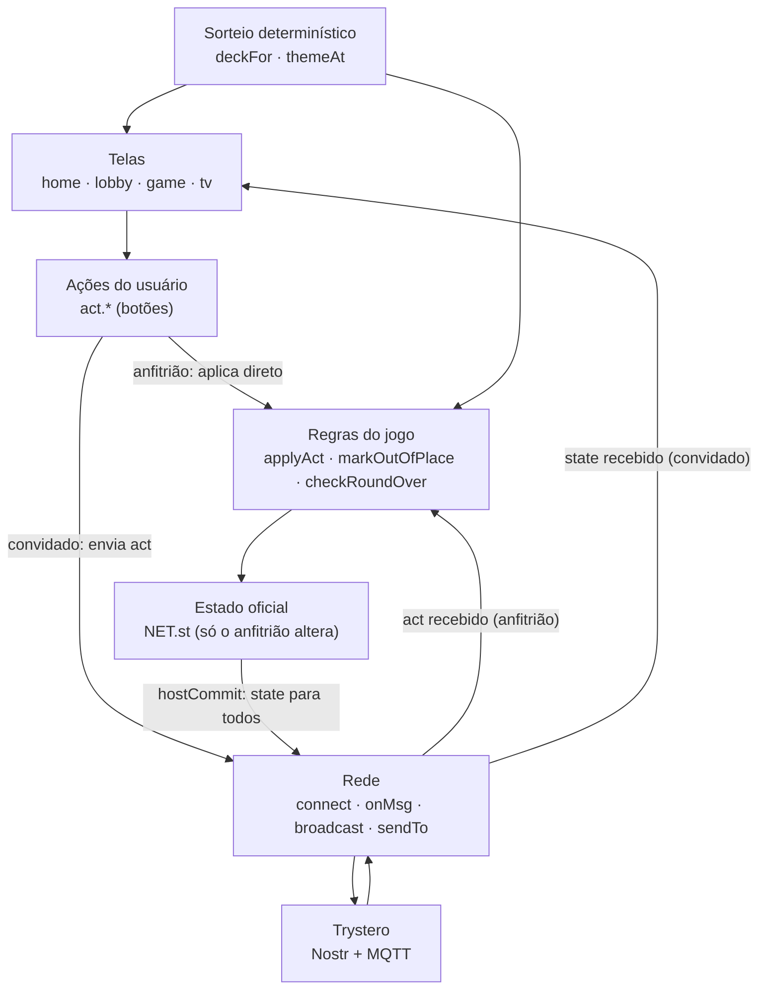

## 2. Visão geral

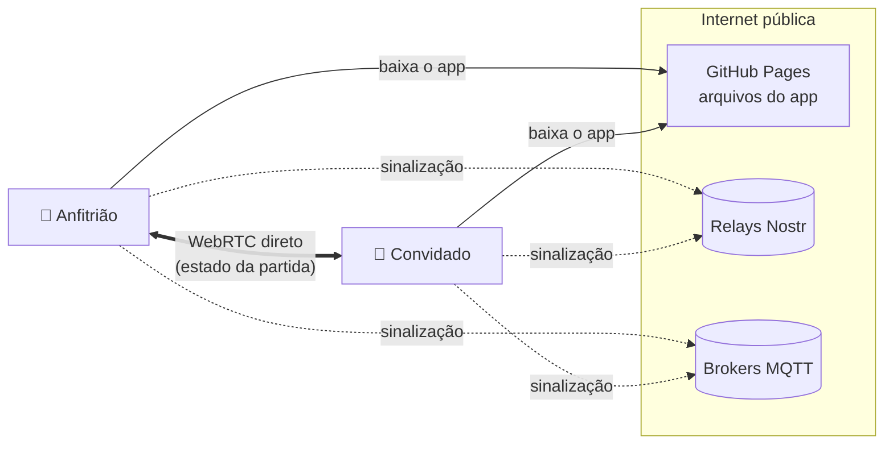

1. Todos baixam o app do GitHub Pages.
2. Cada celular entra numa "sala" de sinalização com o nome do código da sala (ex.: `KQXT-AVCR`).
3. Pelos relays, os celulares trocam as ofertas WebRTC (SDP e candidatos ICE).
4. A conexão direta abre e, a partir daí, **a partida trafega só entre os celulares**. Os relays deixam de ser usados.

### Passo a passo da conexão

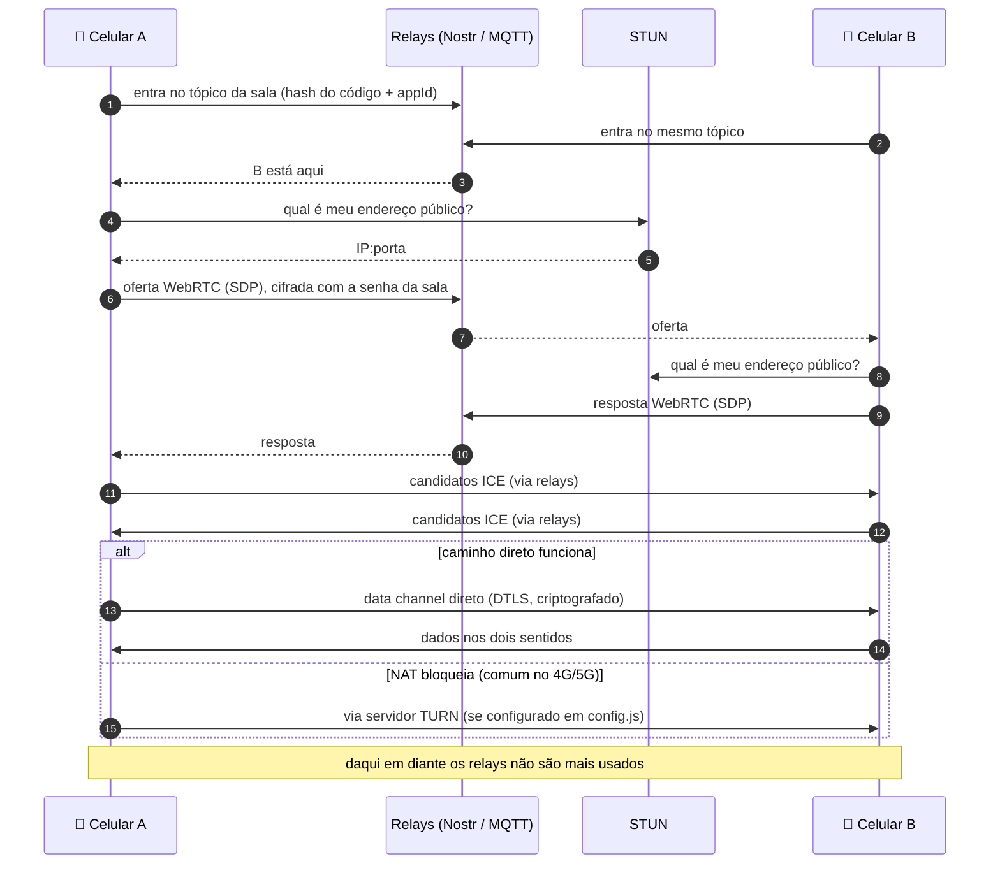

## 3. Duas redes ao mesmo tempo

O app entra na mesma sala por **duas redes de sinalização em paralelo**: Nostr e MQTT. Se uma estiver fora do ar ou bloqueada, a outra segura.

```js
// app.js — connect()
const P2P = {
  n: ['https://cdn.jsdelivr.net/npm/@trystero-p2p/nostr@0.25.4/+esm', 'https://esm.sh/@trystero-p2p/nostr@0.25.4'],
  m: ['https://cdn.jsdelivr.net/npm/@trystero-p2p/mqtt@0.25.4/+esm',  'https://esm.sh/@trystero-p2p/mqtt@0.25.4']
};
const room = lib.joinRoom({ appId: APP_ID, password: code, turnConfig }, code);
```

- Cada rede tem um endereço reserva (esm.sh) caso o jsDelivr falhe.
- A senha da sala é o próprio código: a negociação só é entendida por quem tem o código.
- Como dois celulares podem ficar conectados **pelas duas redes**, cada conexão recebe um prefixo (`n:abc123`, `m:xyz789`), e o app mapeia as duas para a mesma pessoa (o `CID`, um identificador guardado no celular).
- Todas as mensagens são **idempotentes**: receber a mesma coisa duas vezes não muda nada. As reações têm um `id` para não aparecerem duplicadas.

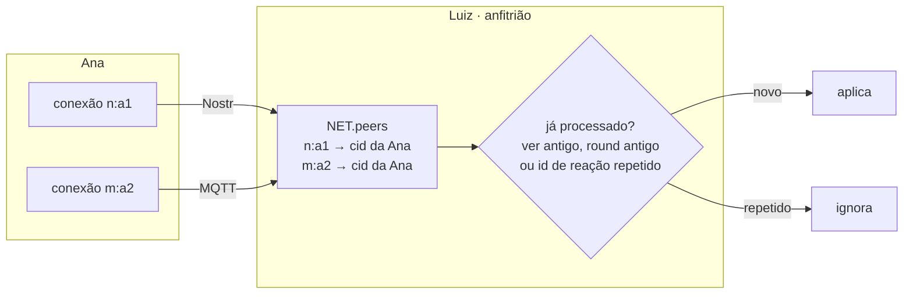

Ana só é considerada **desconectada** quando as duas conexões caem.

## 4. O código da sala carrega a configuração

O código tem 8 letras, como `KQXT-AVCR`:

- `KQXT`: sorteio da sala, que serve de semente das cartas e dos temas.
- `AVCR`: número de jogadores, número de rodadas e categorias de tema, codificados em base 24, sem as letras I e O para evitar confusão.

```js
// valor = ((jogadores-2) * 20 + (rodadas-1)) * 256 + máscara_de_categorias
function enc(n, rounds, mask) { ... }      // → 4 letras
function parseCode(raw) { ... }            // → { code, n, rounds, mask }
```

Assim, quem digita o código já sabe tudo da sala, e o plano B (modo sem conexão) funciona mesmo sem rede.

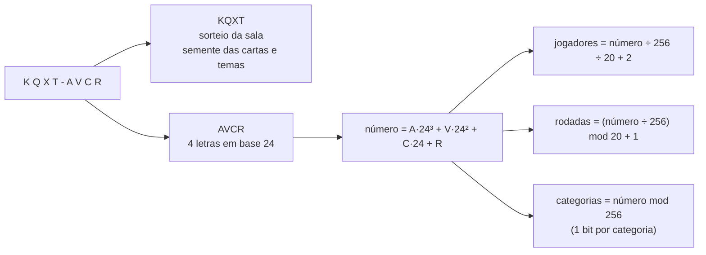

## 5. Ninguém envia as cartas: sorteio determinístico

Todos os celulares geram **o mesmo baralho embaralhado** a partir da mesma semente:

```js
const deckFor = (code, game, round) => shuffle([1..100], rng(code + '|' + game + '|' + round));
// carta do jogador no lugar N = deckFor(...)[N-1]
```

- `rng` é um gerador pseudoaleatório (xmur3 + mulberry32): mesma semente, mesma sequência, em qualquer aparelho.
- O tema da rodada usa a mesma ideia (`themeAt(code, posição)`).
- Consequência: a rede só transmite **decisões** (quem jogou, ordem, votos, dicas), nunca números. Ninguém digita a própria carta, então ninguém consegue mentir pelo app.

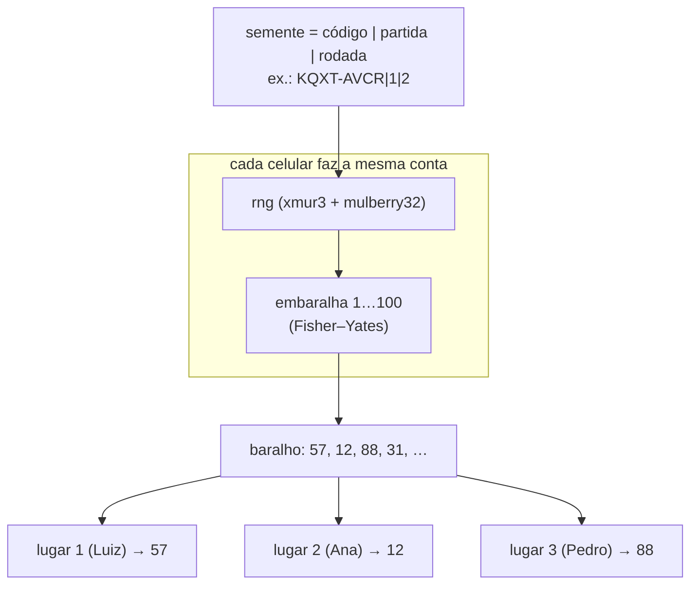

Cada celular mostra só a própria carta. As outras só aparecem quando vão para a mesa.

## 6. Anfitrião: a fonte da verdade

Para evitar conflitos (dois celulares discordando do estado), **um celular manda**: o anfitrião.

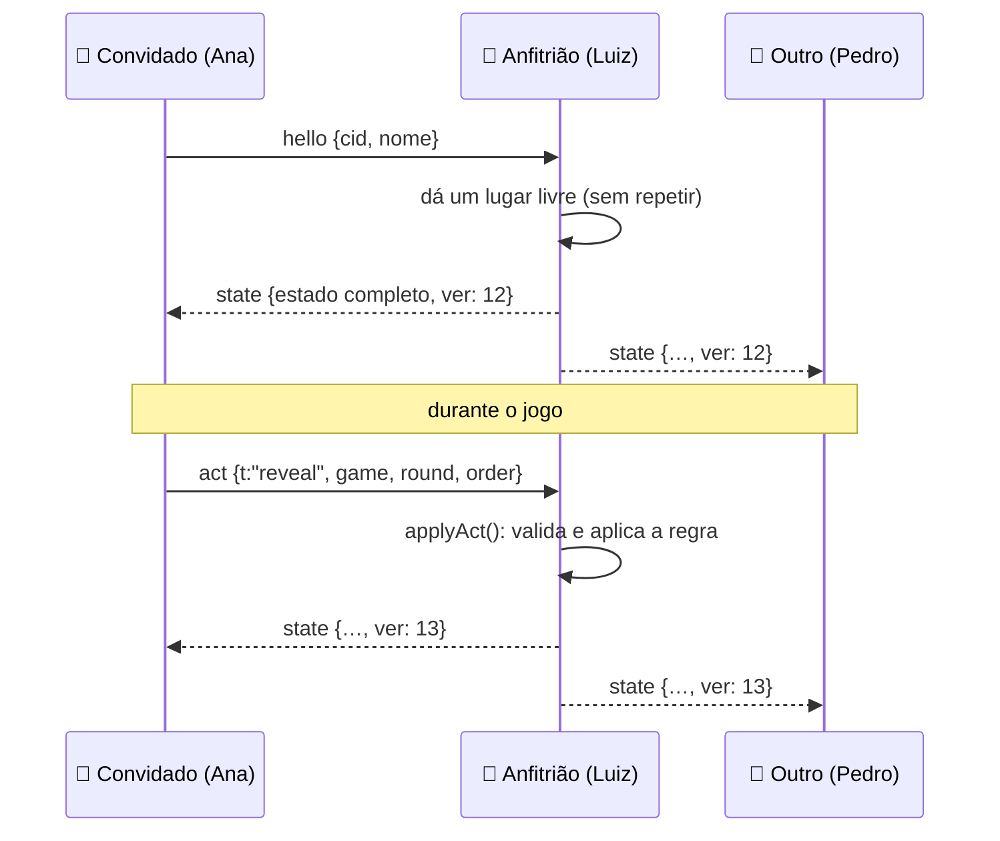

### Estado (`NET.st`)

```js
{
  code, rounds, mask,             // configuração da sala
  hostCid, ver,                   // quem é o anfitrião e a versão do estado
  players: [{seat, cid, name, on}],
  phase: 'lobby' | 'play' | 'done',
  game, round, results, themePos, // andamento
  table: [{seat, card, ok}],      // cartas na mesa, na ordem em que foram reveladas
  plan, hints, vote, custom,      // ordem combinada, dicas, votação, tema da turma
  log, history, ev                // registro das rodadas, placar da noite, último evento
}
```

Cada mudança aumenta `ver`, e o anfitrião envia o estado inteiro para todos (`hostCommit()`). Os convidados aceitam só estados mais novos (`newerState()`).

### Mensagens

| Mensagem | De → para | Para quê |
|---|---|---|
| `hello {cid, name, spectator}` | todos → todos | Apresentação. O anfitrião dá um lugar, o telão (`spectator`) só assiste |
| `state {st}` | anfitrião → todos | Estado oficial completo |
| `act {a}` | convidado → anfitrião | Pedido de ação: `start`, `play`, `plan`, `reveal`, `next`, `skip`, `custom`, `voteStart`, `vote`, `voteEnd`, `hint`, `restart`, `kick`, `move` |
| `name {name}` | convidado → anfitrião | Mudou o nome |
| `bye` | convidado → anfitrião | Saiu da sala |
| `react {e, by, id}` | qualquer → todos | Reação com emoji (não passa pelo estado) |
| `full` / `kicked` / `closed` | anfitrião → convidado | Sala cheia, removido ou sala encerrada |

### Telão (TV ou notebook)

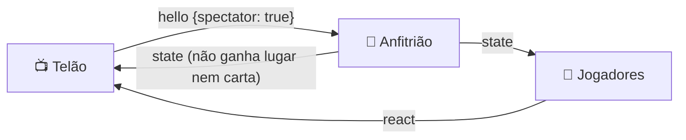

### Ciclo da partida

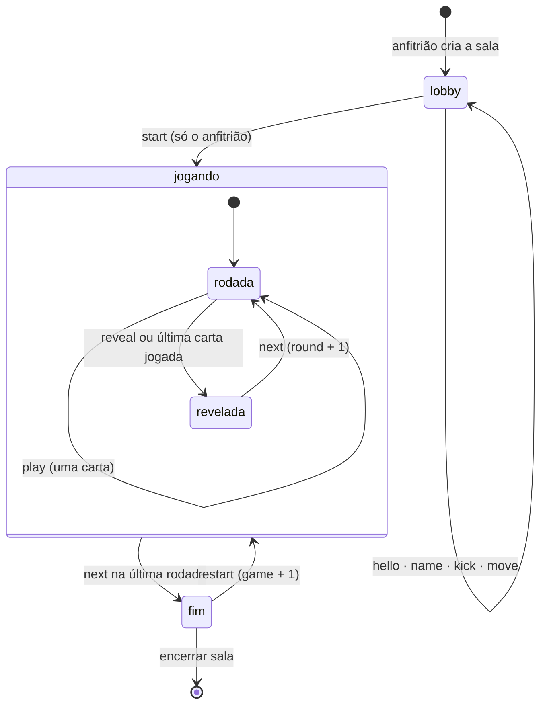

### Toques ao mesmo tempo contam uma vez

Toda ação leva junto `game`, `round` (e `themePos`). O anfitrião só aplica se bater com o estado atual:

```js
const fresh = a.game === st.game && a.round === st.round;
if (a.t === 'next' && fresh && st.roundOver) { ... }   // o 2º "próxima rodada" chega com round antigo e é ignorado
```

### Quem está fora do lugar

Quando a rodada termina, o anfitrião marca como erradas **só as cartas fora do lugar**: mantém a maior sequência crescente e marca o resto (`markOutOfPlace()`).

## 7. Presença e troca de anfitrião

O app sabe quem está conectado pelo mapa `NET.peers` (conexão → `cid`). Uma pessoa só é considerada desconectada quando cai **nas duas redes**.

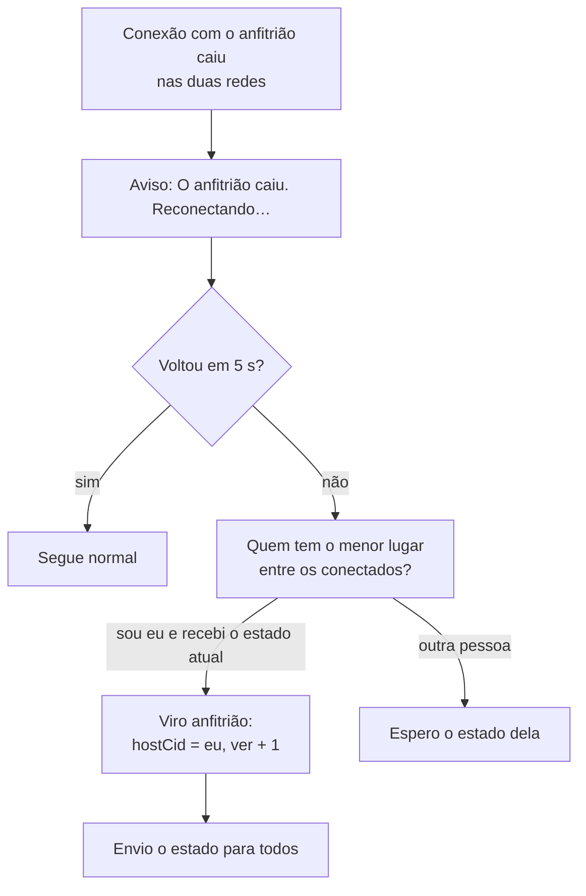

- Só assume quem recebeu o estado **nesta sessão** (`NET.fresh`). Isso impede que um celular que acabou de recarregar, com estado velho, tome o controle.
- Se o antigo anfitrião voltar, ele recebe um estado com `ver` maior e outro `hostCid`, e **vira convidado** automaticamente.
- Em caso de empate de versão, vence o menor `hostCid`, para não ficar trocando.
- Quem não está conectado sai da conta da rodada (as cartas dele não bloqueiam o fim da rodada).

### Quando o antigo anfitrião volta

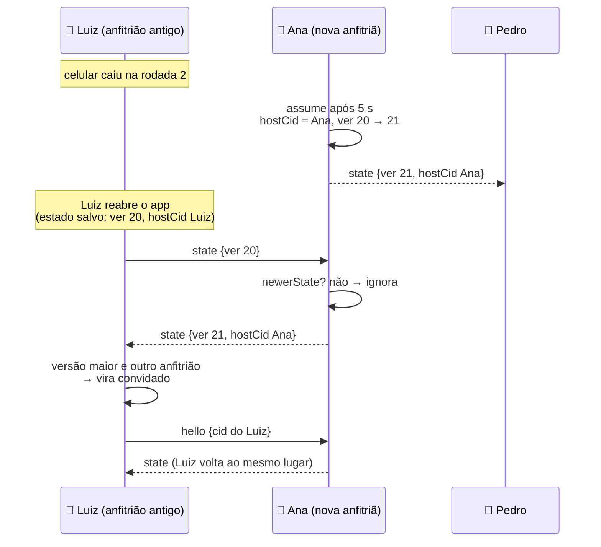

## 8. Guardado no celular

| Chave (`localStorage`) | Conteúdo |
|---|---|
| `ito-cid` | Identificador fixo do celular (para voltar ao mesmo lugar) |
| `ito-name` | Nome escolhido |
| `ito-online` | Sala atual, papel (`host`, `guest`, `tv`) e último estado, para reabrir o app e voltar à sala |
| `ito-game-v2` | Partida do modo sem conexão |
| `ito-sound`, `ito-tips` | Preferências |

## 9. Plano B: modo sem conexão

Se a biblioteca não carregar (sem internet) ou a sala não for encontrada em 15 segundos, aparece **"Jogar sem conexão"**. Nesse modo:

- cada pessoa escolhe seu número de lugar;
- o sorteio determinístico garante as mesmas cartas e temas em todos os celulares;
- todos apertam o mesmo botão (Acertamos/Erramos) ao fim da rodada.

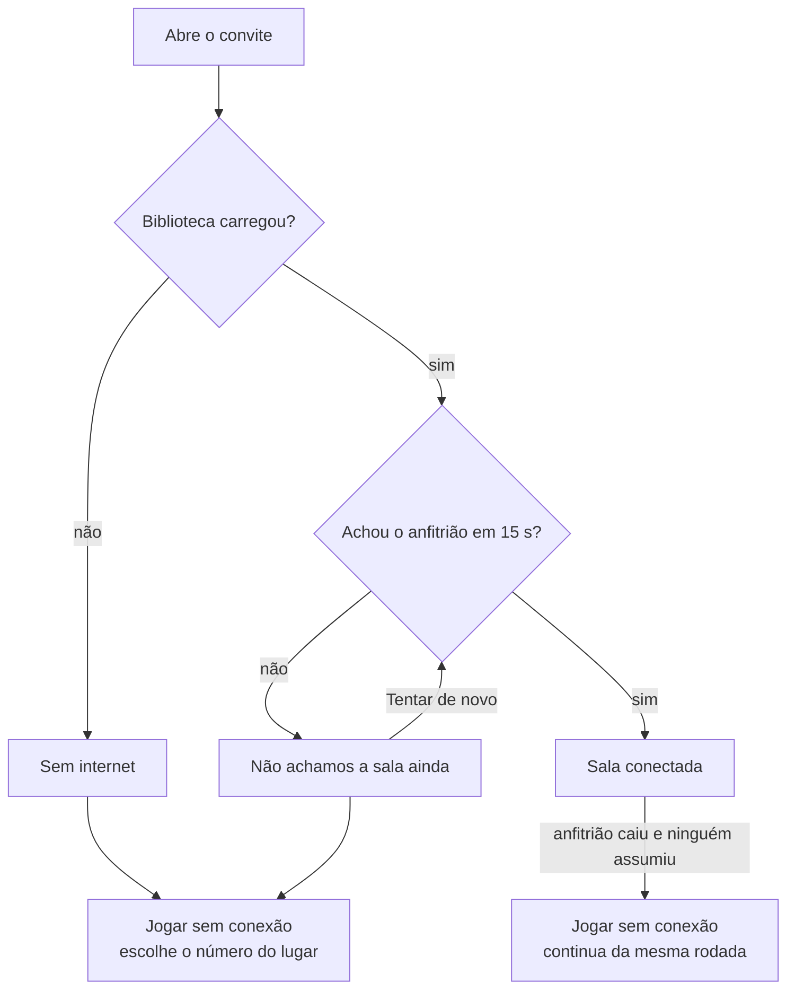

Se o anfitrião cair no meio do jogo, também dá para seguir sem conexão de onde parou.

## 10. Carregamento e cache

- A biblioteca vem do jsDelivr, com esm.sh de reserva (`loadLib()`).
- O `sw.js` guarda uma cópia (cache `ito-lib-1`) para não depender do CDN a cada abertura.
- O app em si fica no cache `ito-<VERSION>`. **Menu → Atualizar app** apaga os caches e recarrega.

## 11. TURN (opcional, recomendado para 4G/5G)

Algumas operadoras usam NAT que impede a conexão direta. Um servidor TURN retransmite os dados (que continuam criptografados de ponta a ponta). Para ativar, preencha `turn` em `config.js` (há o passo a passo no próprio arquivo, usando o plano gratuito da Metered). O app passa a lista para o Trystero via `turnConfig`.

## 12. Limitações conhecidas

- **Precisa de internet** para a primeira conexão (sinalização). Depois de conectados, o tráfego é direto.
- **Sem TURN**, alguns pares em redes móveis podem não conseguir se conectar.
- **Dependência de serviços públicos:** relays Nostr, brokers MQTT, STUN e CDN são de terceiros e podem ficar fora do ar. As duas redes e os endereços reserva reduzem o risco.
- **Anfitrião como fonte da verdade:** em caso de rede dividida, pode haver dois anfitriões por alguns segundos. Quando a rede volta, prevalece o estado de versão maior.
- **Não é à prova de trapaça:** como as cartas são calculadas no próprio celular, alguém que saiba inspecionar o código no navegador poderia descobrir os números. Para um jogo entre amigos isso é aceitável. Impedir exigiria um servidor que guardasse as cartas.
- **Privacidade:** o código da sala é a senha da negociação. Quem tiver o código pode entrar (o anfitrião pode remover).

## 13. Como é testado

Os testes end-to-end (`tests/e2e`) trocam a biblioteca real por um **relé falso** (`fake_p2p.mjs`) que imita as duas redes dentro do próprio teste.

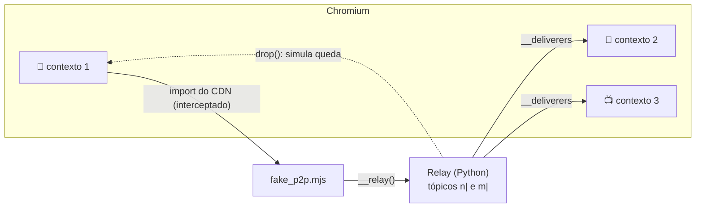
 Assim dá para simular vários celulares, o telão, a queda do anfitrião e toques simultâneos sem depender da internet. Veja [`tests/e2e/README.md`](../tests/e2e/README.md).

## 14. Mapa do código (`app.js`)

| Função | Papel |
|---|---|
| `connect()` / `loadLib()` | Carrega o Trystero e entra na sala pelas duas redes |
| `sendTo()` / `broadcast()` / `sendToCid()` | Envio de mensagens |
| `onPeerJoin()` / `onPeerLeave()` | Presença |
| `onMsg()` | Recebe e trata as mensagens |
| `hostHello()` | Anfitrião recebe quem chegou e dá um lugar |
| `applyAct()` | Regras do jogo (só o anfitrião executa) |
| `playSeat()` / `markOutOfPlace()` / `checkRoundOver()` | Cartas na mesa, fora do lugar, fim da rodada |
| `hostCommit()` | Aumenta a versão, salva e envia o estado |
| `hostLost()` / `newerState()` | Troca de anfitrião |
| `deckFor()` / `themeAt()` | Sorteio determinístico |
| `startHost()` / `startGuest()` / `netReset()` | Ciclo de vida da sala |
