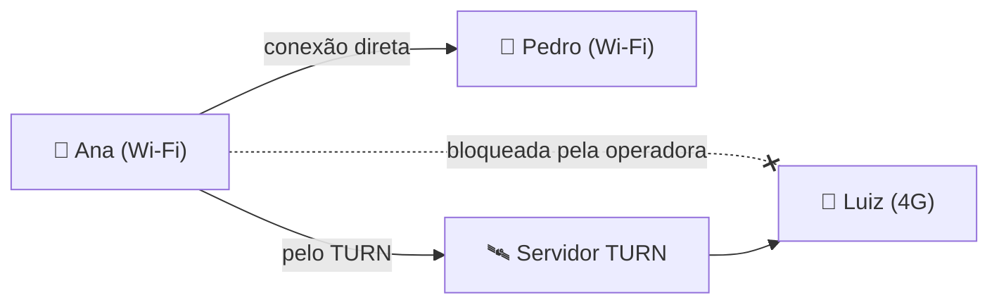

# Ligar o servidor TURN (para quem joga no 4G/5G)

Na maioria das vezes os celulares se conectam direto, sem ajuda. Algumas operadoras de celular bloqueiam essa conexão direta, e aí a pessoa fica presa em "Entrando na sala…". Um **servidor TURN** resolve: ele só repassa os dados entre os celulares (que continuam criptografados de ponta a ponta, o servidor não consegue ler as jogadas).

Leva uns 10 minutos e dá para fazer tudo pelo navegador, sem instalar nada.



## 1. Criar a conta grátis

1. Abra <https://www.metered.ca/stun-turn> e crie uma conta (o plano gratuito basta para jogos entre amigos; ele tem um limite mensal de tráfego, e o ito usa muito pouco porque só manda textos curtos).
2. No painel, crie um app (qualquer nome, por exemplo `ito`).
3. Abra **TURN Server → Credentials** e clique em **Add Credential**. Dê um nome (`ito`) e, se quiser, um limite de uso.
4. Clique em **Instructions** ao lado da credencial. Aparece uma lista `iceServers` com vários endereços, um `username` e um `credential`.

## 2. Colar no app

1. No GitHub, abra o repositório e o arquivo [`config.js`](../config.js).
2. Clique no lápis (**Edit this file**).
3. Troque `turn: []` pela lista que a Metered mostrou. Use **só as linhas que começam com `turn:` ou `turns:`** (as de `stun:` não precisam):

```js
window.ITO_CONFIG = {
  turn: [
    { urls: 'turn:global.relay.metered.ca:80',                username: 'SEU_USUARIO', credential: 'SUA_SENHA' },
    { urls: 'turn:global.relay.metered.ca:80?transport=tcp',  username: 'SEU_USUARIO', credential: 'SUA_SENHA' },
    { urls: 'turn:global.relay.metered.ca:443',               username: 'SEU_USUARIO', credential: 'SUA_SENHA' },
    { urls: 'turns:global.relay.metered.ca:443?transport=tcp', username: 'SEU_USUARIO', credential: 'SUA_SENHA' }
  ]
};
```

4. Abra também [`sw.js`](../sw.js) e [`js/core.js`](../js/core.js) e aumente o número de `VERSION` nos dois (por exemplo de `2.0.0` para `2.0.1`). Assim os celulares percebem que tem versão nova.
5. Clique em **Commit changes**. Em um ou dois minutos o GitHub Pages publica.

## 3. Conferir

1. No celular, abra o app. Deve aparecer "Nova versão disponível"; toque para atualizar (ou use **Menu → Atualizar app**).
2. Teste com uma pessoa no Wi-Fi e outra no 4G.
3. No painel da Metered, em **Usage**, aparece o tráfego depois da partida.

## Bom saber

- **A senha fica visível no site.** Como o app não tem servidor, qualquer pessoa que abrir o código da página consegue ver o usuário e a senha do TURN. O pior que pode acontecer é alguém gastar o seu limite grátis. Por isso vale colocar um limite na credencial (passo 1.3) e, se perceber uso estranho, apagar a credencial e criar outra.
- **Funciona sem TURN também.** Se a lista ficar vazia, o app segue usando só a conexão direta.
- **Outros serviços** que entregam usuário e senha fixos funcionam do mesmo jeito: é só colar os endereços `turn:`/`turns:` no mesmo formato.
