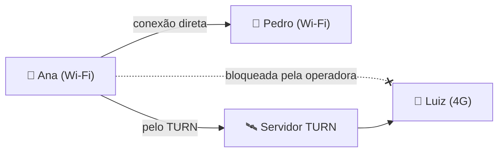

# Servidor TURN (4G, 5G e VPN)

Na maioria das vezes os celulares se conectam direto, sem ajuda. Algumas operadoras, VPNs e redes de celular bloqueiam essa conexão direta, e aí a pessoa fica presa em "Entrando na sala…". Um **servidor TURN** resolve: ele só repassa os dados entre os celulares (que continuam criptografados de ponta a ponta, o servidor não consegue ler as jogadas).



## No app publicado

O site em <https://sschonss.github.io/ito/> já pede credenciais ao Worker `https://ito-turn.sschonss.workers.dev` (Cloudflare Realtime TURN). Elas duram 24 horas. O app guarda a resposta no celular até uns 5 minutos antes de vencer, para não pedir de novo a cada reconexão. Se o pedido falhar, demorar mais que uns 3 segundos ou vier quebrado, a sala abre do mesmo jeito: usa a lista `turn` de [`config.js`](../config.js), se houver, ou segue só com a conexão direta.

A chave secreta do TURN fica só no Worker. Ela não está neste repositório. O Worker só responde para `https://sschonss.github.io` e para `localhost` / `127.0.0.1`.

Para conferir: abra o app no Wi-Fi e no 4G ou numa VPN, entre na mesma sala e jogue uma rodada. Se aparecer "Nova versão disponível", toque para atualizar (ou use **Menu → Atualizar app**).

## Usar outro TURN (Metered)

Quem for publicar uma cópia própria, ou não quiser o Worker, pode usar um serviço com usuário e senha fixos. O plano grátis da Metered basta para jogos entre amigos (o ito só manda textos curtos).

1. Abra <https://www.metered.ca/stun-turn>, crie uma conta e um app (por exemplo `ito`).
2. Em **TURN Server → Credentials**, clique em **Add Credential**. Se quiser, ponha um limite de uso.
3. Em **Instructions**, copie os endereços que começam com `turn:` ou `turns:` (os de `stun:` não precisam).
4. Em [`config.js`](../config.js), deixe `turnUrl: ''` e preencha `turn`:

```js
window.ITO_CONFIG = {
  turnUrl: '',
  turn: [
    { urls: 'turn:global.relay.metered.ca:80',                username: 'SEU_USUARIO', credential: 'SUA_SENHA' },
    { urls: 'turn:global.relay.metered.ca:80?transport=tcp',  username: 'SEU_USUARIO', credential: 'SUA_SENHA' },
    { urls: 'turn:global.relay.metered.ca:443',               username: 'SEU_USUARIO', credential: 'SUA_SENHA' },
    { urls: 'turns:global.relay.metered.ca:443?transport=tcp', username: 'SEU_USUARIO', credential: 'SUA_SENHA' }
  ]
};
```

5. Aumente `VERSION` em [`sw.js`](../sw.js) e [`js/core.js`](../js/core.js) (por exemplo de `2.0.1` para `2.0.2`) e publique.

Se `turnUrl` e `turn` estiverem os dois preenchidos, o app usa os dois: primeiro as credenciais do Worker, depois a lista fixa.

## Bom saber

- **A senha fixa fica visível no site.** Quem cola usuário e senha em `config.js` deixa isso no código da página. O pior que pode acontecer é alguém gastar o limite grátis. Por isso vale limitar a credencial e, se o uso parecer estranho, trocar a senha. As credenciais do Worker não têm esse problema: duram um dia e a chave não vai para o site.
- **Funciona sem TURN também.** Com `turnUrl` vazio e `turn` vazio, o app segue só na conexão direta.
- **Outros serviços** com usuário e senha fixos entram no mesmo formato, em `turn`.
